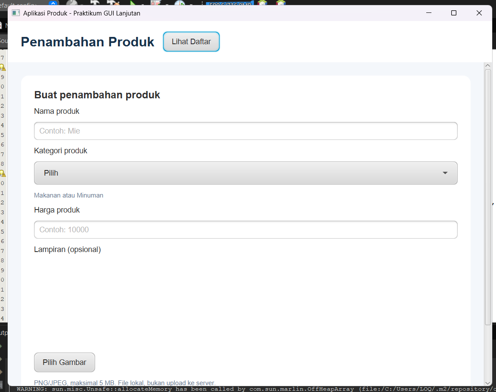
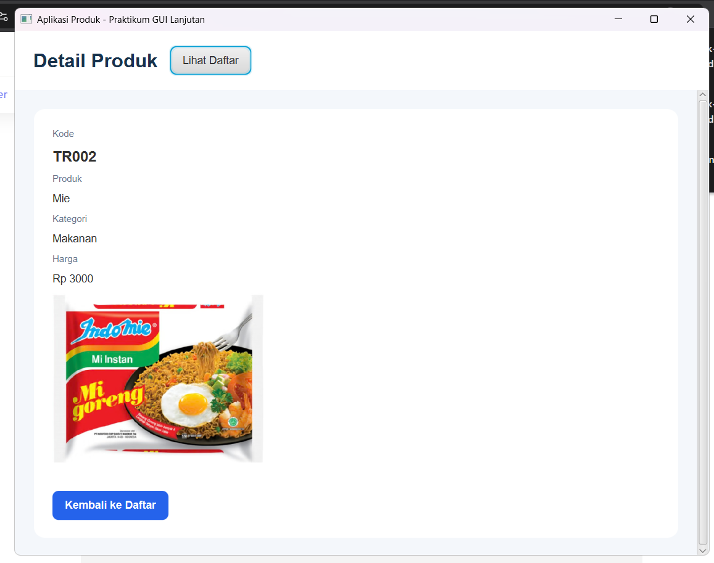
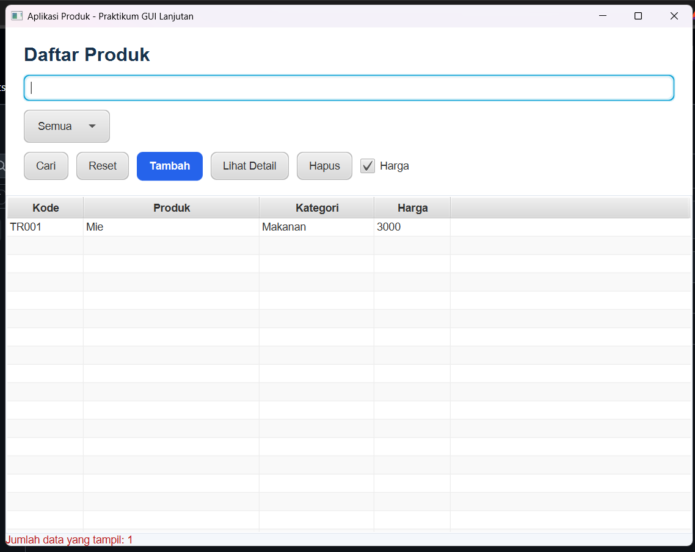

# Toko Produk - Aplikasi Manajemen & Kasir Produk

Aplikasi manajemen produk dan inventaris berbasis *desktop* menggunakan **JavaFX**.

## Deskripsi

**Toko Produk** adalah aplikasi sistem manajemen produk sederhana yang dirancang dengan menerapkan arsitektur MVC (*Model-View-Controller*). Aplikasi ini memudahkan pengguna untuk mencatat data produk baru (lengkap dengan kode otomatis, nama, kategori, harga, dan lampiran gambar), mengelola daftar produk dalam tabel interaktif dengan fitur pencarian serta filter, dan melihat halaman rincian detail produk secara dinamis menggunakan sistem navigasi terpusat.

## Tampilan Aplikasi
Berikut adalah contoh dari tampilan simulasi dari produk toko:

### 1. Tampilan Form (Input Data)
<p align="center">
  
</p>

### 2. Tampilan Detail (Detail Data)
<p align="center">
  
</p>

### 3. Tampilan Daftar (Daftar Data)
<p align="center">
  
</p>

## Fitur Utama

- **Manajemen Data Produk**: Menambahkan, melihat daftar, dan menghapus data produk secara *real-time*.
- **Generate Kode Otomatis**: Sistem otomatis menghasilkan kode unik (seperti `TR001`, `TR002`, dst.) untuk setiap produk baru.
- **Pencarian & Filter Kategori**: Mencari produk berdasarkan kode/nama serta memfilter berdasarkan kategori produk.
- **Lampiran Gambar**: Mendukung pemilihan file gambar lokal (PNG/JPEG) sebagai lampiran pada produk dengan validasi ukuran.
- **Navigasi Terpusat**: Perpindahan halaman yang mulus menggunakan *Navigator* dengan pola *dependency injection*.

## Teknologi

- **Java**
- **JavaFX**
- **FXML**
- **Maven**
- **IDE**: NetBeans / IntelliJ IDEA

## Struktur Proyek

```text
TokoProduk/
├── pom.xml
├── nbactions.xml
├── README.md
├── SS/
│   ├── Daftar-produk.png[cite: 1]
│   ├── Detail-produk.png[cite: 1]
│   └── Form-produk.png[cite: 1]
└── src/
    └── main/
        ├── java/
        │   ├── Model/
        │   │   └── produk.java[cite: 1]
        │   ├── data/
        │   │   └── DataProduk.java[cite: 1]
        │   └── kelas/
        │       ├── controller/
        │       │   ├── DaftarController.java
        │       │   ├── DetailController.java
        │       │   └── FormController.java
        │       ├── MainApp.java[cite: 1]
        │       └── Navigator.java[cite: 1]
        └── resources/
            └── kelas/
                ├── styles/
                │   └── app.css[cite: 1]
                ├── daftar.fxml[cite: 1]
                ├── detail.fxml[cite: 1]
                └── form.fxml[cite: 1]
```

## Persyaratan

- JDK 26 atau versi yang kompatibel dengan konfigurasi proyek.
- Maven.
- JavaFX yang dikelola melalui dependensi Maven.

## Cara Menjalankan

1. Clone repositori.
2. Buka folder proyek di NetBeans atau IDE yang mendukung Maven.
3. Pastikan JDK yang digunakan sesuai dengan konfigurasi proyek.
4. Tunggu Maven mengunduh dependensi yang diperlukan.
5. Jalankan aplikasi menggunakan Maven

## Lisensi

Belum ditentukan.
